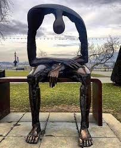
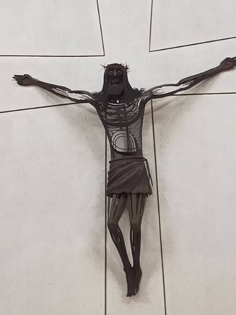
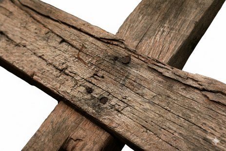
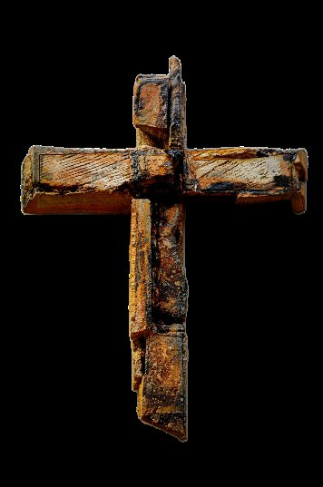

## Introducció

Una creu es forma quan quatre camins s’entrecreuen. Quatre camins que podrien ser molts més, potser infinits. Quatre punts cardinals que podrien simbolitzar un ampli ventall de procedències diverses. La família respon bé a aquest model. La comunitat de veïns, el barri, el poble, la ciutat... la societat, també. En el seu encreuar-se; els camins, les vides, configuren un punt comú, un punt on és possible trobar-se o enfrontar-se. Però, malgrat molts enfrontaments, un espai on trobar-se hauria de ser sempre possible si descobrim un terreny que sigui comú, que pertanyi a tothom. Un espai on ningú en tingui l’ús exclusiu, i encara menys la propietat. On ningú pugui imposar-hi normes de forma unilateral, ni establir-hi formes específiques de comportament, que serien limitades i parcials. És espai comú!

En la nostra cultura, sovint, se’ns presenta la creu on hi ha clavat Jesús de Natzaret. Té certa lògica perquè és el símbol del cristianisme i el punt central de la fe cristiana. En una societat laica i plural, però, aquest símbol representa només un dels múltiples camins de la vida que s’entrecreuen. Hi ha una representació escultòrica del Crucificat que, des de fa molts anys, em provoca un trasbals interior especialment rellevant. Es tracta de l’obra de Demetri Kontos (1925 – 2001), artista de Cadaqués, que presideix el presbiteri de la Parròquia del Port de la Selva. La creu és inexistent i es limita a unes línies sobre la paret blanca, com si d’un mapa de camins es tractés. La figura de Jesús, de ferro, deixa entreveure el fons, com si l’artista volgués simular una certa transparència que invita a mirar, a pensar, a anar més enllà. Però el que a mi sempre m’ha captivat es el buit central que presenta la figura de Jesús. Una porta oberta, impossible de tancar. Una mena de buit que convida a entrar-hi, un buit que sembla voler aixoplugar tots els buits existencials de la humanitat. També el meu, és clar. Un buit que, quan va morir la meva filla gran, vaig descobrir en tota la seva profunditat. Un buit que va saber plasmar amb gran expressivitat l’artista plàstic i escultor romanès, Albert György (Lueta, Transilvània, 1949), en la seva obra situada a Ginebra (Suïssa) que s’anomena “*El buit de l’ànima*” (també *Melanconia*). Possiblement, en algun moment que no sabria precisar, aquests dos buits s’han unit dins meu.

<figure class="article-figure image-pair">

<figcaption>A l'esquerra, <em>Mélancolie</em>, escultura d'Albert György (Ginebra). A la dreta, el Crist de ferro de l'església de Santa Maria de les Neus (el Port de la Selva), obra de Demetri Kontos. <cite>Fotos: <a href="https://commons.wikimedia.org/wiki/File:Melancholia_Sculpture_Lake_Geneva.jpg" target="_blank" rel="noopener">Ranga Sampath</a>, <a href="https://creativecommons.org/licenses/by-sa/4.0/" target="_blank" rel="noopener">CC BY-SA 4.0</a>, via Wikimedia Commons (retallada); Crist del Port de la Selva, Francesc Brunés</cite></figcaption>
</figure>

I les trobades acostumen a ser generadores. La trobada de dos buits que són conscients que només l’Amor pot apaivagar la seva set d’immensitat, segurament, resulta extremadament fecunda. Aquests darrers anys he anat transitant un camí que m’ha fet anar d’un buit a l’altre. Del buit immens deixat per l’absència d’una vida sense paraules i plena a vesar d’amor, a aquell buit d’Amor, empara i recer de tots els altres buits. Aquest camí m’ha portat a explorar la profunditat de la condició humana en un recorregut d’anada i tornada entre el més íntim de l’ésser humà i la seva capacitat relacional. Un camí que més aviat és una espiral que permet a la persona descobrir, en la fondària del seu ésser, la seva intrínseca capacitat de relació; i en la riquesa del seu teixit de relacions, la seva més profunda humanitat. Una espiral que, amb sorpresa, he descobert que conflueix en un punt de trobada, en un espai comú. El Crist de ferro de l’església del Port de la Selva podria anomenar-se *La creu de tothom*. Segurament no és així, però aquell buit al centre de la figura del crucificat ho suggereix. Un encreuament de camins, un espai obert, buit, on la humanitat s’hi pot aplegar.

## Qui és tothom?

El buit de la creu, un espai per a tothom, sense exclusió de cap mena. Però, qui és tothom? De fet, si aquest encreuament ha de ser un espai on trobar-se sense cap indici d’exclusió, convé assegurar-se que el terme ‘tothom’ no sigui només un recurs semàntic. En català, certament, l’expressió ‘tothom’ té vocació de ser inclusiva, ja que s’utilitza per referir-nos a totes les persones, homes o dones, qualsevol persona vingui d’on vingui, pensi el que pensi, sigui qui sigui... Però, ja se sap que una cosa és el dit i una altra el fet. És habitual fer servir el terme ‘tothom’ per referir-se a un col·lectiu determinat, la qual cosa seria, en certa manera, una contradicció en si mateix. En una classe, diem: demà tothom ha de portar el treball; un tothom que afecta només als alumnes. En una església, diem: diumenge que ve tothom és convidat a la celebració...; un tothom que, molt probablement, incorpora de manera subjacent un horitzó que no pretén anar més enllà dels feligresos. Serien molts els exemples en què, conscientment o inconscient, la paraula ‘tothom’ porta incorporat un cercle, tan ampli com es vulgui, però mai del tot universal.

Les persones de confessió cristiana, ens podem preguntar: I per a Jesús, qui deu ser ‘tothom’? L’Evangeli no enganya. Podem espigolar d’aquí i d’allà i, sense gaire esforç podrem fer-nos-en una idea suficientment aclaridora.

Les persones humanes som proclius a classificar. Ho fem amb les espècies, amb el coneixement, amb les coses... i també amb les persones. En un món molt polaritzat, la classificació de les persones és entre bons i dolents. Nosaltres, naturalment, ens situem a la banda dels bons i, sense adonar-nos-en, el nostre ‘tothom’ acaba al llindar on habiten els dolents. Sovint ens agradaria que aquells dolents no hi fossin, que es convertissin o deixessin de molestar. Una cosa semblant li van plantejar els apòstols a Jesús quan volien eliminar les males herbes (el jull) dels camps de blat. La resposta de Jesús és inequívoca*: “No ho feu pas, no fos cas que, arrencant el jull, arrenquéssiu també el blat. Deixeu que creixin junts fins al temps de la sega”* (Mt 13, 29). Per si quedava algun dubte, en un altre passatge, Jesús, després d’indicar que cal estimar els enemics, afegeix: *“Així sereu fills del vostre Pare del cel, que fa sortir el sol sobre bons i dolents i fa ploure sobre justos i injustos”* (Mt 5, 45). No sembla que Jesús sigui partidari de massa classificacions. El seu ‘tothom’ no exclou ningú. Tanmateix, Jesús a la creu mostra plenament que el seu patiment no fa minvar la seva inclusivitat. De fet, diu a un dels dos criminals que l’acompanyaven al Gòlgota: “*En veritat t’ho dic: avui seràs amb mi al paradís*” (Lc 23,43). Una promesa de paradís que no consta que hagués fet a ningú al llarg de la seva vida, ni tan sols a cap dels seus deixebles o seguidors. La fa a un criminal, senyal que el seu ‘tothom’, com el seu amor, no té límits.

El món que hem construït provoca l’empobriment, sempre injust, de moltes regions del planeta. Els seus habitants es veuen empesos a marxar cap altres indrets on aixoplugar-se de la violència, la pobresa, la devastació del medi natural, l’espoliació... Això provoca moltes tensions i grans reptes a la convivència entre les persones autòctones d’un lloc i aquelles que han arribat des d’altres indrets. La diversitat necessita diàleg i no etiquetes classificatòries que estigmatitzen i creen prejudicis. També aquí el ‘tothom’ pot reduir-se, volent o sense voler, a aquelles persones que porten la mateixa etiqueta. Què hi diu Jesús? Mirem què en diu un dels primers “aprenent de cristià”, l’apòstol Pau: *“Ja no hi ha jueu ni grec, esclau ni lliure, home ni dona: tots sou un de sol en Jesucrist”* (Ga 3, 28). I en una altra carta, el mateix Pau diu: *“Aquí ja no hi ha grec ni jueu, circumcís ni incircumcís, bàrbar ni escita, esclau ni lliure; només hi ha el Crist, que ho és tot i és en tots”* (Col 3, 11). Aquesta afirmació, Pau la fa després d’haver dit: *“No us enganyeu els uns als altres, vosaltres que us heu despullat de l’home vell i de les seves obres i us heu revestit de l’home nou, que es va renovant a imatge del seu creador i avança cap al ple coneixement”* (Col 3, 9-10). Sembla com si Pau, l’apòstol dels diferents, ens estès adreçant cap a l’espai comú: Jesús, l’home nou, renovat a imatge del seu creador. És a dir, custodi de la Trinitat, diversitat de Persones distintes, en absoluta Unitat. Potser aquest sigui un primer pas, però no el definitiu, com veurem més endavant.

En general, els fets ens diuen més que les paraules. Per això, pot ser útil algun tast de com Jesús, no només predicava un ‘tothom’ sense límits, sinó que el practicava en la seva vida quotidiana. A l’hora de l’àpat: *“Més tard, mentre era a taula a casa seva, van acudir-hi molts publicans i altres pecadors i es posaren a taula amb Jesús i els seus deixebles”* (Mt 9, 10). Sabem com van reaccionar els qui estaven instal·lats en el seu ‘tothom’ d’homes bons. També quan té set en el pou de Jacob i demana aigua: *“Dona’m aigua [...] Com és que tu, que ets jueu, em demanes aigua a mi, que soc samaritana?* (Jn 4, 9) Sabem que la dona, a més de ser dona i samaritana (o sigui, estrangera), era una dona de vida tèrbola. Jesús no li fa un discurs, li demana aigua. Fer un sermó hauria situat els dos personatges del passatge en dos cercles diferents: l’home bo i la dona dolenta. Demanant aigua, Jesús estableix un pont per on poder arribar a un punt de trobada.

Hi ha un altre passatge que sempre m’ha semblat molt rellevant. És de l’Evangeli de Mateu: “*on n’hi ha dos o tres de reunits en el meu nom, jo soc allí enmig d’ells*” (Mt 18,20). Jesús promet la seva presència, la presència de Déu, allà on hi hagi dues o tres persones que s’apleguen en nom seu. No posa cap etiqueta a les persones, no diu qui han de ser, ni quin carnet han de tenir, ni a quin club han de pertànyer. Diu, senzillament, dos o tres, un cercle prou ampli, un tothom inclusiu.

Tanmateix, sorprèn la capacitat de Jesús per deixar sempre espai a la trobada. Trobem a l’Evangeli de Joan un diàleg entre Pilat i Jesús (Jn 18, 37-38). Diu Jesús: “*Tots els qui són de la veritat escolten la meva veu*”. Li diu Pilat: “*I què és la veritat*”. I Jesús que havia dit “*jo soc el camí, la veritat i la vida*” (Jn 14,6), no respon. Crec que Jesús no calla per por, ni per amagar la seva condició divina, sinó per deixar oberta la possibilitat de trobar-se. De la mateixa manera que a la creu dona l’oportunitat als seus botxins de fer un darrer acte de misericòrdia. “*Després d’això, Jesús, sabent que ja tot s’havia acomplert, perquè s’acabés de complir l’Escriptura va dir: tinc set*” (Jn 19, 28). També en aquell moment especialment difícil dona una remota possibilitat a l’amor, a la trobada, al vincle.

He triat aquests passatges, però podrien ser molts altres. Tanmateix, n’hi ha un, també en l’Evangeli de Joan, que esvaeix qualsevol dubte sobre la universalitat del ‘tothom’ de Jesús: *“Que tots siguin u, com tu, Pare, estàs en mi i jo en tu”* (Jn 17, 21). Aquestes paraules formen part de la pregària més agosarada que Jesús adreça al Pare, en una intimitat inimaginable. Ho fa poc abans que comencés el procés de la seva Passió i mort a la creu. De fet, diuen que és la seva darrera pregària amb els deixebles. Sembla, doncs, alguna cosa més que un desig, potser un testament. Jesús en la profunditat inabastable del seu dolor; demana, suplica al Pare un punt de trobada per a tothom. Un lloc on sigui possible, en la més genuïna diversitat, la unitat més radical, aquella que constitueix la vida mateixa de la Trinitat. Com hem vist abans, l’apòstol Pau ja ens presenta Jesús com l’home – nou, l’home -món, que aplega tothom. Però aquest ‘tots’ (tothom) que Jesús suplica al Pare, pot excloure els qui no creuen en Ell? Sabem que la resposta ha de ser: no, però, de moment deixem la pregunta oberta.

## Qui hi ha a la creu?

Sigui com sigui, Jesús després d’aquella pregària va acabar a la creu. I amb la creu passa com amb els encreuaments de camins, a vegades semblen deserts, a vegades hi ha un tràfec intens, i en algunes ocasions tenim la sensació d’estar-hi tot sols. De representacions de la creu se n’han fet de tota mena al llarg de la història. Durant els segles I i II no s’hi posava la figura de Jesucrist, més endavant començarà a aparèixer-hi sense mostres de patiment, més aviat majestuós. No serà fins als segles XIII-XIV quan es comencen a trobar creus amb un Jesús sofrent. Avui en dia, tret de la “creu de terme” present encara a moltes poblacions, cal buscar la creu només dins de les esglésies, ermites, convents i santuaris. N’hi trobarem de tota mena. En ocasions la creu és nua, sense cap figura humana; en d’altres, l’artista juga amb el perfil de la creu per provocar una ombra que sembla una figura. Representacions des de l’art modern o contemporani, i també del més pur classicisme. Diversitat d’inspiracions, diversitat de camins, que porten a un mateix encreuament. De fet, la “creu de terme” generalment es troba a l’entrada de la població, allà on comencen els carrers, on els camins es creuen, punt de trobada de les diversitats, de la gent del poble i dels de fora.

<figure class="article-figure">

<figcaption>Encreuament de bigues de fusta. <cite>Foto: <a href="https://pixabay.com/users/congerdesign-509903/" target="_blank" rel="noopener">congerdesign</a> / <a href="https://pixabay.com/photos/cross-wooden-cross-wood-good-friday-3262919/" target="_blank" rel="noopener">Pixabay</a></cite></figcaption>
</figure>

Hi ha creus de fusta, unes més sòlides, d’altres més fràgils i poroses. N’hi ha de pedra aspra i de marbre fi. També n’hi ha de ferro, senzill i humil; i de metalls i pedres precioses, que ens recorden els contrastos de la vida. I quan a la creu hi ha alguna figura, aquesta és la d’un home: Jesús de Natzaret. Un aprenent de fuster, encara jove, jutjat sense justícia, condemnat sense delicte i executat amb la pena més cruel i humiliant. A la creu hi ha un home fracassat. Punt de trobada dels molts fracassos que homes i dones experimentem al llarg de la vida: dolor, pèrdua, malaltia, patiment, angoixa, soledat, injustícia, incomprensió, desorientació, desànim, manca de sentit... mort (*la creu de tothom*). Punt de trobada, també, de la diversitat de mirades dipositades sobre aquesta figura desfigurada. Per a uns és només un fuster fracassat, per a d’altres un profeta mig guillat, per a d’altres un home bo víctima del poder de l’època, i per a molts, el Fill de Déu.

Per a tots els cristians al llarg dels segles, a la creu hi ha Déu fet carn agonitzant. I al peu de la creu, una dona, una mestressa de casa; Maria, la seva mare. I una altra dona, Maria Magdalena. La Mare verge i la dona de vida turmentada, aplegades en el punt de trobada de la creu. Un cercle sense límits. Punt de trobada de totes les mares (i pares) que al llarg de la història han perdut els seus fills o filles. Una pèrdua que sempre sembla fora de lloc, fora de temps i que massa vegades arriba de la mà de les injustícies, la fam, les violències o les guerres. Un home i una dona, un fill i una mare, dos cors encongits pel patiment extrem. Punt de trobada de tots els patiments de la humanitat sencera. I Maria Magdalena. I els soldats, i alguns badocs. Per a uns, s’havia fet justícia; per a d’altres, s’havia comès una injustícia. Per als seguidors de Jesús, era un escàndol de grans proporcions. Déu, mort en una creu, en un encreuament de camins que amenaçava esdevenir diàspora, enlloc de punt de trobada. Sí, això hi havia a la creu. Però, no tot pot ser tan aparent, tan simple... encara hi ha molt més.

## El crit

Sí, deu haver-hi alguna cosa més. Creiem el que creiem, si superem l’escull dels prejudicis, possiblement intuirem que allà, en aquella creu de tothom, hi ha algun misteri, alguna cosa que se’ns escapa. Ser cristians no ens eximeix del misteri, la creença ens aporta esperança, creiem que Jesús va vèncer la mort i que l’Amor és sempre més gran que la mort. Tot i això, el centre de la fe i la cultura cristianes, continua essent la creu. A la primera carta de Sant Pau als cristians de Corint els hi diu: *“Mentre era enmig vostre, vaig decidir de no conèixer res més que Jesucrist, i encara crucificat”* (1Co 2, 2). Aquelles hores al Gòlgota amaguen algun secret de profunditat insondable. No sembla insignificant un fet que els quatre evangelistes recullen en el seu Evangeli: Jesús no va morir sol: *“Juntament amb ell van crucificar dos bandolers, l’un a la seva dreta i l’altre a la seva esquerra”* (Mc 15, 27). A més de Maria, Maria Magdalena, Joan i alguns acompanyants que podrien considerar-se partidaris seus; i dels soldats que hi eren per obligació, amb Jesús van ser executats dos malfactors. Jesús, a l’hora de la seva mort, era al mig de dos homes que no devien ser gaire bon jans per acabar d’aquella manera. El missatge de l’escena, sembla clar, Jesús va morir també per aquells dos. De fet va morir per a tothom, el tothom de veritat, aquell que no exclou. Sant Pau diu als Corintis a la segona carta: *“I ell ha mort per tots”* (2Co, 5, 15).

És a dir, Jesús mor per a tothom i, a més, abans de morir havia suplicat al Pare “que tots siguin u”. Com pot ser possible això, si hi ha gent que no creu que Jesús fos Déu? Gent que no creu en res transcendent. Gent que creu en altres déus. Chiara Lubich, fundadora del Moviment dels Focolars, receptora del carisma de la unitat, situa la centralitat del carisma rebut en el misteri que amaga aquella creu de tothom. La unitat de la família humana és la resposta a aquell prec de Jesús: “Que tots siguin u” i Jesús a la creu n’és la seva clau. Però Chiara Lubich es fixa en un moment absolutament especial del patiment de Jesús, aquell que, segons ella, representa el cim de tots els patiments experimentats per Jesús: el seu abandonament. Des d’una perspectiva segurament curta de mires, semblaria que hi hauria moltes altres maneres de redimir la humanitat, de mostrar al món la grandesa i la potència de Déu. Però no, la seva majestuositat va ser experimentar el no-res. Diu l’evangelista Marc: *“I a les tres de la tarda, Jesús va cridar amb tota la força: – Eloí, Eloí, ¿lemà sabactani? –que traduït vol dir: « Déu meu, Déu meu, per què m’has abandonat? “* (Mc 15, 34). Aquest crit, crec fermament que és l’encreuament de la creu de tothom, on és possible el somni de Jesús “que tots siguin u”, l’únic lloc on el “tothom” no té límits. L’únic lloc on tothom s’hi pot trobar, l’únic lloc on és possible construir, teixir, la fraternitat universal.

No vull fer teologia, ni barata ni cara, perquè no en sé. Només recullo i comparteixo una experiència espiritual, un camí espiritual, orientat i inspirat per l’Ideal del carisma de la unitat: caminar per fer possible el prec de Jesús “que tots siguin u”. Un prec on el ‘tots’ és un ‘tothom’ sense límits. Altrament, el sacrifici de Jesús a la creu hauria estat en va. Darrere d’aquell crit, crec que hi ha un encreuament, un punt, un instant, un infinit, un misteri insondable. És, possiblement, només un instant, un moment en què Jesús se sent abandonat de Déu. Dolor inimaginable. Moment que Jesús és només home, l’únic moment de la seva vida que només va ser home. El moment més important de tota la seva vida, el cim de la redempció. Jesús “deixant” de ser Déu, obre un punt de trobada: la nostra humanitat compartida, la seva i la nostra. Jesús que forma part de la Trinitat, en aquell moment, hi obre una ferida a través de la qual tothom, d’alguna manera incomprensible, passa a formar part d’aquest model de convivència que permet “que tots siguem u”. Essent el moment de màxim patiment de Jesús és també el moment en què la mesura del seu amor es fa il·limitada, incondicional. L’espai obert, és un espai d’amor sense límits. I aquí pren rellevància allò que Jesús havia dit als seus deixebles en el context del darrer sopar i després de haver-los-hi rentat els peus: “*Us dono un manament nou: que us estimeu els uns als altres tal com jo us he estimat*” (Jn 13, 34). Frase que inclou un adverbi transcendental: com. La mesura de l’amor rau en aquell ‘com’. Jesús va arribar a l’extrem de perdre-ho tot com a home i de “perdre” també, en certa manera, la seva condició divina en el moment que es va sentir abandonat del Pare. Només així és possible que el cercle del ‘tothom’ no tingui límits. Per això, possiblement, aquest manament de Jesús perviu al llarg de la història en el que es considera la “regla d’or”: “*Tracta als altres com t'agradaria ser tractat*". Una frase acceptada per gairebé totes les religions i també per persones sense cap mena de referència religiosa. Un model de convivència que no s’atura en les creences, que no posa cap mena d’etiqueta, que respon al ‘tothom’ del centre de la creu.

## Humanitat

<figure class="article-figure">

<figcaption>Creu rovellada. <cite>Foto: <a href="https://pixabay.com/users/ben_kerckx-69781/" target="_blank" rel="noopener">Ben_Kerckx</a> / <a href="https://pixabay.com/photos/cross-crucifix-faith-religion-982103/" target="_blank" rel="noopener">Pixabay</a></cite></figcaption>
</figure>

Els cristians diríem “divina humanitat”, perquè Jesús ens ha redimit i això ens ha donat la dignitat de fills d’un mateix Pare, fills de Déu, d’alguna manera “divinitzats”. Però hi ha vida més enllà del cristianisme. Hi ha gent que no creu en Jesús ni en la seva redempció, estan exclosos d’aquell “que tots siguin u”? Jesús va viure i patir, només per uns quants? Sabem que no. Diu l’evangelista Mateu: *“Quan Jesús va saber que Joan havia estat empresonat, es retirà a Galilea; però va deixar Natzaret i se n’anà a viure a Cafarnaüm, vora el llac, en els territoris de Zabuló i de Neftalí”* (Mt 4, 12-13). Els territoris de Zabuló i Neftalí, eren zones paganes, de depravació, corrupció i mala vida. Jesús no hi va de visita o de passada. Mateu diu: “se n’anà a viure”. Massa evidències per excloure ningú d’aquest espai de trobada obert per Jesús a la intersecció de la creu.

Tinc el convenciment que en aquell instant d’humanitat nua de Jesús, una humanitat que és també la nostra, hi ha la possibilitat (potser l’única) de trobar un punt de trobada sense límits. Un espai de relacions sense etiquetar, de trobada infinita per caminar plegats, compartint allò que ens uneix profundament: la condició humana. Una condició que Jesús va assolir també en exclusiva, ni que fos per un moment, obrint així la porta d’aquest punt de trobada infinit. Perquè Jesús no va venir a etiquetar, sinó a unir respectant la diversitat. No ens trobarem en cap de les nostres pertinences que sempre seran cercles limitats i tancats, per molt amplis que pretenguin ser. En canvi, sí que ens podem trobar en l’única etiqueta que compartim: la d’humans. Però, què vol dir trobar-nos en la nostra nua humanitat?

La fondària de la condició humana, possiblement, sigui inabastable. Per això, només esmento breument alguns trets de la nostra humanitat que crec que afavoreixen la trobada entre nosaltres i, segurament, també amb Déu. El fet que som éssers relacionals per naturalesa, fa que tot el que portem dins s’adreci a la relació i ens fa conscients que només les relacions ens poden permetre descobrir en profunditat la humanitat que compartim. Alguns d’aquests elements que considero bàsics són:

Caminar oberts a la dimensió espiritual que habita dins nostre. Conrear la nostra interioritat, l’escolta de la consciència, la capacitat de discerniment que espera la resposta ètica que brolla del nostre interior. L’espiritualitat ens obre a la trobada, a cercar la relació fraterna.

El diàleg amb nosaltres mateixos ens fa conscients de les nostres limitacions, de les dels altres, de les de l’entorn. Aquesta consciència ens situa en la humilitat necessària per saber que la trobada només pot ser enriquidora.

La trobada enriqueix mútuament, i això obre la porta a l’agraïment i a la confiança que, només junts, podem aspirar a trobar sentit al que vivim, a les coses que passen i a les que ens passen.

La dignitat és consubstancial i comuna a la condició humana. Trobar-nos colze a colze, en un espai comú, compartit, ens fa més conscients de la dignitat inalienable de tota persona, més enllà de les diferències més fondes.

La igual dignitat empeny a desenvolupar la profunditat de l’empatia, una capacitat de la naturalesa humana que ens fa millors, ens guareix, millora el món i ens compromet els uns amb els altres.

Les persones humanes portem incorporada una eina fonamental per a superar les dificultats de la vida, de les relacions; els obstacles dels enfrontaments i les divisions: la paciència, la virtut dels forts.

Els éssers relacionals estem dotats, inevitablement, de la capacitat de diàleg, de conversa, de comunicació. El diàleg que segueix el model trinitari, és un diàleg que fecunda i transforma.

Estem fets a imatge i semblança de Déu. Per això som relació = Trinitat. Unes relacions amarades d’amor, perquè: *“El qui no estima no coneix Déu, perquè Déu és amor”* (1Jn, 4, 8). Sense l’amor la vida de relació seria un infern, per això, els humans compartim la capacitat d’estimar, d’estimar-nos.

Només amb aquests elements, parcials i limitats, que compartim tots els humans, n’hi hauria prou per descobrir el punt central de la creu. Aquell punt de trobada on el cercle és infinit. Aquell lloc que no és ni vertical, ni horitzontal, és comú. Un espai que és humà perquè és diví i és diví perquè és humà. Un lloc on cadascú pot ser més qui és: el musulmà pot descobrir la profunditat de la seva fe, el cristià pot esdevenir més i millor cristià, l’agnòstic pot explorar el sentit del misteri, el solidari pot ampliar la seva generositat; el lluitador per la igualtat i la justícia, pot trobar encara més sentit al seu afany, ... Les etiquetes no desapareixen, sinó que se situen al servei de la condició humana que permet a un tothom sense exclusions entrar per aquella ferida sense porta del centre de la creu, per trobar-nos i caminar la vida plegats.

## La casa de tothom

Trobar-nos a la casa sense sostre ni parets que aquell crit de Jesús ha construït per a tothom és possible. Una casa sense límits fonamentada en aquell instant on a la creu només hi ha humanitat. Amb aquell crit, Jesús esborra l’abisme entre l’humà i el diví, elevant la condició humana a una categoria “divinitzada”, on la trobada és possible per a tothom. Perquè tots som humans: home o dona, d’aquí o d’allà, tant se val el que pensem, el que creiem, el que fem o el que deixem de fer. Si Déu és Amor, és també llibertat, perquè l’amor és sempre lliure. Per això, la casa de tothom no té parets, ni sostre, no hi ha requisits per entrar-hi, ni per sortir-ne. És un punt de trobada especial i únic, situat al bell mig de Déu mateix. Ser-ne conscient o no, és secundari; creure-ho o no, és secundari. El fet important és que, en aquell lloc, només la condició humana ens fa iguals i diferents. És el lloc ideal per exercir la nostra dignitat inalienable i la nostra llibertat per cercar el sentit de la vida, explorar els misteris que ens transcendeixen, explorar les pors, les incerteses i els dubtes. Una casa acollidora per tornar-hi una vegada i una altra, perquè s’hi està bé, perquè poder essent allà ja hem arribat a port, tot i que per camins ben diferents.

Qualsevol altra casa amb parets i sostre, qualsevol cercle limitat, no és el de Jesús. Només el lloc del “tothom” sense límits és l’espai on es pot respirar l’aire de la Trinitat, potser sense saber-ho. Un aire que ens apropa entre nosaltres, mantenint intacte la nostra singularitat. Un aire que ens esperona a seguir camins diferents, cadascú el seu, per arribar, possiblement, al mateix lloc, a la casa de tothom. Viure aquesta experiència profundament humana permet, doncs, respirar l’aire del diví, que no es veu, només es percep. Saber-ne o no la procedència, creure que ve de dalt o de baix, crec sincerament, que no és essencial. Respirar-lo, sí que és essencial, perquè si no ho fem, morim. Potser no físicament, però mor la nostra humanitat en la seva més pregona expressió: l’obertura espiritual a allò desconegut.

Pouar en les aigües de la nostra més profunda condició humana és una experiència personal, certament. Cadascú ha de fer la seva, i en el diàleg sincer i honest amb la seva consciència anirà trobant les respostes ètiques que orienten i donen sentit a la seva vida, a les coses que fa i a les que no fa, a les coses que passen i a les que li passen. Però això no queda reclòs dins de cadascú, perquè conèixer la fondària del que som com a persones humanes, ens empeny inevitablement a la trobada, perquè som éssers relacionals per naturalesa. I aquesta capacitat innata de dialogar, de crear relacions noves, de buscar espais de cooperació i col·laboració, té unes repercussions socials innegables. La bona convivència, en una societat plural i diversa, depèn en bona mesura d’això. Sense el conreu d’aquesta dimensió essencial de la persona, la convivència agonitza en un ball de cercles tancats, on cadascú tracta de portar els altres al seu cercle. Imposició, manipulació i engany; ús de la força: de les armes, dels interessos, de l’economia. Abús matusser de les emocions, dels sentiments; xantatges inacceptables, asimetries que fereixen o maten. Tot s’hi val per tractar d’eixamplar el meu cercle que serà sempre limitat i que només pot sobreviure a base de la confrontació amb els altres cercles. Lluita de poders, baralles de pati d’escola. Tot això afebleix la convivència, sovint, la malmet; provoca patiment, injustícia, desigualtat... Tot allò que a la casa de tothom, sense sostre ni parets, no hi té cabuda, perquè allà només hi ha espai per al “tothom” sense límits.

A la casa de tothom, la condició humana és la xarxa que aixopluga el patiment, les limitacions, les finituds, les pèrdues, els buits... tot el que és inherent a la nostra humanitat. Una xarxa de relacions que es va teixint amb l’amor i el dolor de cada persona. Una munió de trobades que recorden el dolor i l’amor de la creu de tothom, que traspuen aires de vida trinitària. Ser-ne conscients o no, tant se val. Uns li posaran una etiqueta, uns altres n’hi posaran una altra, però, comptat i debatut, l’única etiqueta que compta per viure és la condició humana que compartim, també amb Jesús. No oblidem que el cercle no té vores, és infinit. Els cristians creiem que Jesús, després de la mort en creu, al tercer dia, va ressuscitar. Però, a vegades, oblidem qui va trobar el sepulcre buit: *“Passat el dissabte, quan clarejava el primer dia de la setmana –el diumenge–, Maria Magdalena i l’altra Maria anaren a veure el sepulcre”* (Mt 28, 1). Déu tria dues dones, una d’elles de vida gens clara, per descobrir i anunciar el gran esdeveniment de la història. Aquell sepulcre buit, potser és també aquell espai, al centre de la creu, que el crit esfereïdor de Jesús va obrir, per fer possible que la creu no sigui meva ni teva, sinó de tothom. Una casa per a tothom, sense exclusions.

Si Jesús es va “despullar” de la seva condició divina, no podem nosaltres “despullar-nos” de les etiquetes que hem adoptat per poder trobar-nos amb tothom? Aquesta trobada sense límits, no és necessària a la vida de família, al barri, a la feina, a la societat...? No és respirar els aires de la vida trinitària?

Deia el Papa Francesc: *“Estima com un pare, deixa’t estimar com un fill i difon l’amor arreu del món. Aquest és el “misteri” de la Trinitat, la resta són guarniments”*. Respirar l’amor, que és la vida de Déu mateix, i que embolcalla la condició humana que compartim, també amb Jesús. Habitar l’espai d’amor il·limitat i incondicional que Jesús va obrir al bell mig de la creu amb el seu crit desesperat d’abandó. No cal mirar qui n’és conscient i qui no, qui s’ho creu i qui no. L’important és fer tot el que estigui a l’abast de cadascú perquè el cercle no tingui límits i tothom, veritablement, pugui gaudir del punt de trobada de la humanitat. El Papa Lleó XIV en la seva segona audiència general del 28/05/2025, va dir: “*Abans que creients estem cridats a ser humans*”. La seva primera encíclica del 15 de maig de 2026 s’anomena “*Magnifica humanitas*”. Allà on som només humans, sense cap etiqueta afegida, és el punt de trobada amb Jesús i amb qualsevol home o dona, amb la humanitat sencera, sense exclusions.

Potser en aquest punt de trobada de la creu de tothom on l’humà i el diví es confonen i difuminen, rau l’essència del carisma de la unitat de Chiara Lubich. Fabio Ciardi conclou el seu llibret <em>Viaggiando il Paradiso</em><a href="#fn-ciardi-ca">1</a> amb aquest paràgraf:

*“La primera i la darrera paraula amb què comença i acaba, respectivament, el text del Paradís ’49, tal com he esmentat a l’inici, em semblen del tot significatives de la paràbola d’aquest extraordinari viatge. La primera, que marca el començament del viatge és “Abbà, Pare”: som al si del Pare, en el Paradís. La darrera, que assenyala l’acabament del viatge és “home”, referint-se a la seva plenitud que és Crist: “Jesús és l’Amor perquè és Déu. Però l’amor amb escreix el va actuar Jesús Abandonat que apareix només home”. Som a la terra amb tot el Paradís dins. La terra en el cel, el cel a la terra. El Paradís que continua avui entre nosaltres...”*

I és potser aquest ‘només’ el que permet que la immensitat del carisma de la unitat pugui penetrar fins el moll de l’ús de cada ésser humà, fins que “tots siguin u”.

<ol><li id="fn-ciardi-ca">
Fabio Ciardi, <em>Viaggiando il Paradiso</em>, Roma, Città Nuova Editrice, 2019, pàgines 63-64. <a href="#fnref-ciardi-ca" class="reversefootnote">↩</a>
</li></ol>

## Introducción

Una cruz se forma cuando cuatro caminos se cruzan. Cuatro caminos que podrían ser muchos más, quizá infinitos. Cuatro puntos cardinales que podrían simbolizar una amplia variedad de procedencias diversas. La familia responde bien a este modelo. La comunidad de vecinos, el barrio, el pueblo, la ciudad… la sociedad, también. En su cruce, los caminos, las vidas, configuran un punto común, un punto donde es posible encontrarse o enfrentarse. Pero, a pesar de muchos enfrentamientos, un espacio donde encontrarse debería ser siempre posible si descubrimos un terreno que sea común, que pertenezca a todos. Un espacio donde nadie tenga su uso exclusivo, y mucho menos su propiedad. Donde nadie pueda imponer normas de forma unilateral, ni establecer formas específicas de comportamiento, que serían limitadas y parciales. ¡Es espacio común!

En nuestra cultura, a menudo, se nos presenta la cruz con Jesús de Nazaret clavado en ella. Tiene cierta lógica, porque es el símbolo del cristianismo y el punto central de la fe cristiana. En una sociedad laica y plural, sin embargo, este símbolo representa solo uno de los múltiples caminos de la vida que se cruzan. Hay una representación escultórica del Crucificado que, desde hace muchos años, me provoca un trasiego interior especialmente relevante. Se trata de la obra de Demetri Kontos (1925-2001), artista de Cadaqués, que preside el presbiterio de la Parroquia del Port de la Selva. La cruz es inexistente y se limita a unas líneas sobre la pared blanca, como si se tratara de un mapa de caminos. La figura de Jesús, de hierro, deja entrever el fondo, como si el artista quisiera simular una cierta transparencia que invita a mirar, a pensar, a ir más allá. Pero lo que a mí siempre me ha cautivado es el vacío central que presenta la figura de Jesús. Una puerta abierta, imposible de cerrar. Una especie de vacío que invita a entrar en él, un vacío que parece querer acoger todos los vacíos existenciales de la humanidad. También el mío, claro. Un vacío que, cuando murió mi hija mayor, descubrí en toda su profundidad. Un vacío que supo plasmar con gran expresividad el artista plástico y escultor rumano Albert György (Lueta, Transilvania, 1949), en su obra situada en Ginebra (Suiza), que se titula «El vacío del alma» (también *Melancolía*). Posiblemente, en algún momento que no sabría precisar, esos dos vacíos se han unido dentro de mí.

<figure class="article-figure image-pair">

<figcaption>A la izquierda, <em>Mélancolie</em>, escultura de Albert György (Ginebra). A la derecha, el Cristo de hierro de la iglesia de Santa Maria de les Neus (El Port de la Selva), obra de Demetri Kontos. <cite>Fotos: <a href="https://commons.wikimedia.org/wiki/File:Melancholia_Sculpture_Lake_Geneva.jpg" target="_blank" rel="noopener">Ranga Sampath</a>, <a href="https://creativecommons.org/licenses/by-sa/4.0/" target="_blank" rel="noopener">CC BY-SA 4.0</a>, vía Wikimedia Commons (recortada); Cristo del Port de la Selva, Francesc Brunés</cite></figcaption>
</figure>

Y los encuentros suelen ser generadores. El encuentro de dos vacíos que son conscientes de que solo el Amor puede calmar su sed de inmensidad resulta, seguramente, extremadamente fecundo. Estos últimos años he ido recorriendo un camino que me ha llevado de un vacío al otro. Del vacío inmenso dejado por la ausencia de una vida sin palabras y llena a rebosar de amor, a aquel vacío de Amor, amparo y refugio de todos los demás vacíos. Este camino me ha llevado a explorar la profundidad de la condición humana en un recorrido de ida y vuelta entre lo más íntimo del ser humano y su capacidad relacional. Un camino que más bien es una espiral que permite a la persona descubrir, en la hondura de su ser, su intrínseca capacidad de relación; y, en la riqueza de su tejido de relaciones, su más profunda humanidad. Una espiral que, con sorpresa, he descubierto que confluye en un punto de encuentro, en un espacio común. El Cristo de hierro de la iglesia del Port de la Selva podría llamarse *La cruz de todos*. Seguramente no es así, pero aquel vacío en el centro de la figura del crucificado lo sugiere. Un cruce de caminos, un espacio abierto, vacío, donde la humanidad puede reunirse.

## ¿Quiénes son todos?

El vacío de la cruz, un espacio para todos, sin exclusión de ningún tipo. Pero ¿quiénes son todos? De hecho, si este cruce ha de ser un espacio donde encontrarse sin ningún indicio de exclusión, conviene asegurarse de que el término «todos» no sea solo un recurso semántico. En catalán, ciertamente, la expresión «*tothom*» tiene vocación de ser inclusiva, ya que se utiliza para referirnos a todas las personas, hombres o mujeres, cualquier persona venga de donde venga, piense lo que piense, sea quien sea… Pero, ya se sabe, una cosa es el dicho y otra el hecho. Es habitual utilizar el término «todos» para referirse a un colectivo determinado, lo cual sería, en cierta manera, una contradicción en sí mismo. En una clase, decimos: mañana todos deben traer el trabajo; un «todos» que afecta solo a los alumnos. En una iglesia, decimos: el domingo que viene todos están invitados a la celebración…; un «todos» que, muy probablemente, incorpora de manera subyacente un horizonte que no pretende ir más allá de los feligreses. Serían muchos los ejemplos en que, consciente o inconscientemente, la palabra «todos» lleva incorporado un círculo, tan amplio como se quiera, pero nunca del todo universal.

Las personas de confesión cristiana podemos preguntarnos: Y para Jesús, ¿quiénes deben ser «todos»? El Evangelio no engaña. Podemos escoger de aquí y de allá y, sin mucho esfuerzo, podremos hacernos una idea suficientemente clara.

Las personas humanas somos proclives a clasificar. Lo hacemos con las especies, con el conocimiento, con las cosas… y también con las personas. En un mundo muy polarizado, la clasificación de las personas es entre buenos y malos. Nosotros, naturalmente, nos situamos del lado de los buenos y, sin darnos cuenta, nuestro «todos» acaba en el umbral donde habitan los malos. A menudo nos gustaría que aquellos malos no estuvieran allí, que se convirtieran o dejaran de molestar. Algo parecido le plantearon los apóstoles a Jesús cuando querían eliminar las malas hierbas (la cizaña) de los campos de trigo. La respuesta de Jesús es inequívoca: *«No lo hagáis, no sea que, al arrancar la cizaña, arranquéis también el trigo. Dejad que crezcan juntos hasta el tiempo de la siega»* (Mt 13, 29). Por si quedaba alguna duda, en otro pasaje, Jesús, después de indicar que hay que amar a los enemigos, añade: *«Así seréis hijos de vuestro Padre del cielo, que hace salir el sol sobre buenos y malos y hace llover sobre justos e injustos»* (Mt 5, 45). No parece que Jesús sea partidario de demasiadas clasificaciones. Su «todos» no excluye a nadie. Sin embargo, Jesús en la cruz muestra plenamente que su sufrimiento no disminuye su inclusividad. De hecho, dice a uno de los dos criminales que lo acompañaban en el Gólgota: *«En verdad te lo digo: hoy estarás conmigo en el paraíso»* (Lc 23, 43). Una promesa de paraíso que no consta que hubiera hecho a nadie a lo largo de su vida, ni siquiera a alguno de sus discípulos o seguidores. La hace a un criminal, señal de que su «todos», como su amor, no tiene límites…

El mundo que hemos construido provoca el empobrecimiento, siempre injusto, de muchas regiones del planeta. Sus habitantes se ven empujados a marchar hacia otros lugares donde refugiarse de la violencia, la pobreza, la devastación del medio natural, el expolio… Esto provoca muchas tensiones y grandes retos a la convivencia entre las personas autóctonas de un lugar y aquellas que han llegado desde otros lugares. La diversidad necesita diálogo y no etiquetas clasificatorias que estigmatizan y crean prejuicios. También aquí el «todos» puede reducirse, queriéndolo o sin quererlo, a aquellas personas que llevan la misma etiqueta. ¿Qué dice Jesús? Miremos lo que dice uno de los primeros «aprendices de cristiano», el apóstol Pablo: *«Ya no hay judío ni griego, esclavo ni libre, hombre ni mujer: todos sois uno solo en Jesucristo»* (Ga 3, 28). Y en otra carta, el mismo Pablo dice: *«Aquí ya no hay griego ni judío, circunciso ni incircunciso, bárbaro ni escita, esclavo ni libre; solo hay el Cristo, que lo es todo y está en todos»* (Col 3, 11). Esta afirmación, Pablo la hace después de haber dicho: *«No os engañéis los unos a los otros, vosotros que os habéis despojado del hombre viejo y de sus obras y os habéis revestido del hombre nuevo, que se va renovando a imagen de su creador y avanza hacia el pleno conocimiento»* (Col 3, 9-10). Parece como si Pablo, el apóstol de los diferentes, nos estuviera dirigiendo hacia el espacio común: Jesús, el hombre nuevo, renovado a imagen de su creador. Es decir, custodio de la Trinidad, diversidad de Personas distintas, en absoluta Unidad. Quizá este sea un primer paso, pero no el definitivo, como veremos más adelante.

En general, los hechos nos dicen más que las palabras. Por eso, puede ser útil algún ejemplo de cómo Jesús no solo predicaba un «todos» sin límites, sino que lo practicaba en su vida cotidiana. Por ejemplo, a la hora de la comida: *«Más tarde, mientras estaba a la mesa en su casa, acudieron muchos publicanos y otros pecadores y se pusieron a la mesa con Jesús y sus discípulos»* (Mt 9, 10). Sabemos cómo reaccionaron los que estaban instalados en su «todos» de hombres buenos. También cuando tiene sed en el pozo de Jacob y pide agua: *«Dame agua […]. ¿Cómo es que tú, que eres judío, me pides agua a mí, que soy samaritana?»* (Jn 4, 9). Sabemos que la mujer, además de ser mujer y samaritana (es decir, extranjera), era una mujer de vida turbia. Jesús no le hace un discurso, le pide agua. Hacer un sermón habría situado a los dos personajes del pasaje en dos círculos diferentes: el del hombre bueno y el de la mujer mala. Pidiendo agua, Jesús establece un puente por el que poder llegar a un punto de encuentro.

Hay otro pasaje que siempre me ha parecido muy relevante. Es del Evangelio de Mateo: *«donde hay dos o tres reunidos en mi nombre, yo estoy allí en medio de ellos»* (Mt 18, 20). Jesús promete su presencia, la presencia de Dios, allí donde haya dos o tres personas que se reúnan en su nombre. No pone ninguna etiqueta a las personas, no dice quiénes han de ser, ni qué carné han de tener, ni a qué club han de pertenecer. Dice, sencillamente, dos o tres, un círculo bastante amplio, un todos inclusivo.

Sorprende la capacidad de Jesús para dejar siempre espacio al encuentro. Encontramos en el Evangelio de Juan un diálogo entre Pilato y Jesús (Jn 18, 37-38). Dice Jesús: *«Todos los que son de la verdad escuchan mi voz»*. Le dice Pilato: «¿Y qué es la verdad?». Y Jesús, que había dicho «yo soy el camino, la verdad y la vida» (Jn 14, 6), no responde. Creo que Jesús no calla por miedo, ni para ocultar su condición divina, sino para dejar abierta la posibilidad de encontrarse. De la misma manera que en la cruz da la oportunidad a sus verdugos de hacer un último acto de misericordia. *«Después de esto, Jesús, sabiendo que ya todo se había cumplido, para que se acabara de cumplir la Escritura, dijo: tengo sed»* (Jn 19, 28). También en aquel momento especialmente difícil da una remota posibilidad al amor, al encuentro, al vínculo.

He escogido estos pasajes, pero podrían ser muchos más. Sin embargo, hay uno, también en el Evangelio de Juan, que disipa cualquier duda sobre la universalidad del «todos» de Jesús: *«Que todos sean uno, como tú, Padre, estás en mí y yo en ti»* (Jn 17, 21). Estas palabras forman parte de la oración más audaz que Jesús dirige al Padre, en una intimidad inimaginable. Lo hace poco antes de que comenzara el proceso de su Pasión y muerte en la cruz. De hecho, dicen que es su última oración con los discípulos. Parece, pues, algo más que un deseo, quizá un testamento. Jesús, en la profundidad inalcanzable de su dolor, pide, suplica al Padre un punto de encuentro para todos. Un lugar donde sea posible, en la más genuina diversidad, la unidad más radical, aquella que constituye la vida misma de la Trinidad. Como hemos visto antes, el apóstol Pablo ya nos presenta a Jesús como el hombre nuevo, el hombre-mundo, que reúne a todos. Pero ese «todos» que Jesús suplica al Padre, ¿puede excluir a los que no creen en Él? Sabemos que la respuesta tiene que ser: no, pero, por el momento, dejemos la pregunta abierta.

## ¿Quién hay en la cruz?

Sea como sea, Jesús después de aquella oración acabó en la cruz. Y con la cruz pasa como con los cruces de caminos: a veces parecen desiertos, a veces hay un trajín intenso y, en algunas ocasiones, tenemos la sensación de estar allí solos. De representaciones de la cruz se han hecho de todo tipo a lo largo de la historia. Durante los siglos I y II no se ponía la figura de Jesucristo; más adelante comenzará a aparecer sin muestras de sufrimiento, más bien majestuoso. No será hasta los siglos XIII-XIV cuando se empiezan a encontrar cruces con un Jesús sufriente. Hoy en día, salvo la «cruz de término» presente todavía en muchas poblaciones, hay que buscar la cruz solo dentro de las iglesias, ermitas, conventos y santuarios. Encontraremos de todo tipo. En ocasiones la cruz está desnuda, sin ninguna figura humana; en otras, el artista juega con el perfil de la cruz para provocar una sombra que parece una figura. Representaciones desde el arte moderno o contemporáneo, y también del más puro clasicismo. Diversidad de inspiraciones, diversidad de caminos, que llevan a un mismo cruce. De hecho, la «cruz de término» generalmente se encuentra a la entrada de la población, allí donde comienzan las calles, donde los caminos se cruzan, punto de encuentro de las diversidades, de la gente del pueblo y de los de fuera…

<figure class="article-figure">

<figcaption>Cruce de vigas de madera. <cite>Foto: <a href="https://pixabay.com/users/congerdesign-509903/" target="_blank" rel="noopener">congerdesign</a> / <a href="https://pixabay.com/photos/cross-wooden-cross-wood-good-friday-3262919/" target="_blank" rel="noopener">Pixabay</a></cite></figcaption>
</figure>

Hay cruces de madera, unas más sólidas, otras más frágiles y porosas. Las hay de piedra áspera y de mármol fino. También las hay de hierro, sencillo y humilde; y de metales y piedras preciosas, que nos recuerdan los contrastes de la vida. Y cuando en la cruz hay alguna figura, esta es la de un hombre: Jesús de Nazaret. Un aprendiz de carpintero, aún joven, juzgado sin justicia, condenado sin delito y ejecutado con la pena más cruel y humillante. En la cruz hay un hombre fracasado. Punto de encuentro de los muchos fracasos que hombres y mujeres experimentamos a lo largo de la vida: dolor, pérdida, enfermedad, sufrimiento, angustia, soledad, injusticia, incomprensión, desorientación, desánimo, falta de sentido… muerte (*la cruz de todos*). Punto de encuentro, también, de la diversidad de miradas depositadas sobre esta figura desfigurada. Para unos es solo un carpintero fracasado; para otros, un profeta medio loco; para otros, un hombre bueno víctima del poder de la época; y, para muchos, el Hijo de Dios.

Para todos los cristianos a lo largo de los siglos, en la cruz está Dios hecho carne agonizante. Y al pie de la cruz, una mujer, una ama de casa; María, su madre. Y otra mujer, María Magdalena. La Madre virgen y la mujer de vida atormentada, reunidas en el punto de encuentro de la cruz. Un círculo sin límites. Punto de encuentro de todas las madres (y padres) que a lo largo de la historia han perdido a sus hijos o hijas. Una pérdida que siempre parece fuera de lugar, fuera de tiempo y que demasiadas veces llega de la mano de las injusticias, el hambre, las violencias o las guerras. Un hombre y una mujer, un hijo y una madre, dos corazones encogidos por el sufrimiento extremo. Punto de encuentro de todos los sufrimientos de la humanidad entera. Y María Magdalena. Y los soldados, y algunos curiosos. Para unos, se había hecho justicia; para otros, se había cometido una injusticia. Para los seguidores de Jesús, era un escándalo de grandes proporciones. Dios, muerto en una cruz, en un cruce de caminos que amenazaba con convertirse en diáspora, en lugar de punto de encuentro. Sí, eso había en la cruz. Pero no todo puede ser tan aparente, tan simple… todavía hay mucho más.

## El grito

Sí, debe haber algo más. Creamos lo que creamos, si superamos el escollo de los prejuicios, posiblemente intuiremos que allí, en aquella cruz de todos, hay algún misterio, algo que se nos escapa. Ser cristianos no nos exime del misterio; la creencia nos aporta esperanza, creemos que Jesús venció la muerte y que el Amor es siempre más grande que la muerte. Aun así, el centro de la fe y la cultura cristianas sigue siendo la cruz. En la primera carta de san Pablo a los cristianos de Corinto les dice: *«Mientras estaba en medio de vosotros, decidí no conocer nada más que a Jesucristo, y aún crucificado»* (1Co 2, 2). Aquellas horas en el Gólgota esconden algún secreto de profundidad insondable. No parece insignificante un hecho que los cuatro evangelistas recogen en su Evangelio: Jesús no murió solo: *«Juntamente con él crucificaron a dos bandidos, uno a su derecha y otro a su izquierda»* (Mc 15, 27). Además de María, María Magdalena, Juan y algunos acompañantes que podrían considerarse partidarios suyos; y de los soldados que estaban allí por obligación, con Jesús fueron ejecutados dos malhechores. Jesús, a la hora de su muerte, estaba en medio de dos hombres que no debían ser muy buena gente para acabar de aquella manera. El mensaje de la escena parece claro: Jesús murió también por aquellos dos. De hecho, murió por todos, el todos de verdad, aquel que no excluye. San Pablo dice a los corintios en la segunda carta: «Y él ha muerto por todos» (2Co 5, 15).

Es decir, Jesús muere por todos y, además, antes de morir había suplicado al Padre «que todos sean uno». ¿Cómo puede ser posible esto, si hay gente que no cree que Jesús fuera Dios? Gente que no cree en nada trascendente. Gente que cree en otros dioses. Chiara Lubich, fundadora del Movimiento de los Focolares, receptora del carisma de la unidad, sitúa la centralidad del carisma recibido en el misterio que esconde aquella cruz de todos. La unidad de la familia humana es la respuesta a aquella súplica de Jesús: «Que todos sean uno», y Jesús en la cruz es su clave. Pero Chiara Lubich se fija en un momento absolutamente especial del sufrimiento de Jesús, aquel que, según ella, representa la cima de todos los sufrimientos experimentados por Jesús: su abandono. Desde una perspectiva seguramente corta de miras, parecería que habría muchas otras maneras de redimir a la humanidad, de mostrar al mundo la grandeza y la potencia de Dios. Pero no, su majestuosidad fue experimentar la nada. Dice el evangelista Marcos: *«Y a las tres de la tarde, Jesús gritó con toda su fuerza: —Eloí, Eloí, ¿lemá sabactani? —que traducido quiere decir: “Dios mío, Dios mío, ¿por qué me has abandonado?”»* (Mc 15, 34). Este grito, creo firmemente que es el cruce de la cruz de todos, donde es posible el sueño de Jesús “que todos sean uno”, el único lugar donde el “todos” no tiene límites. El único lugar donde todos pueden encontrarse, el único lugar donde es posible construir, tejer, la fraternidad universal…

No quiero hacer teología, ni barata ni cara, porque no sé. Solo recojo y comparto una experiencia espiritual, un camino espiritual, orientado e inspirado por el Ideal del carisma de la unidad: caminar para hacer posible la súplica de Jesús «que todos sean uno». Una súplica donde el «todos» es un «todos» sin límites. De lo contrario, el sacrificio de Jesús en la cruz habría sido en vano. Detrás de aquel grito, creo que hay un cruce, un punto, un instante, un infinito, un misterio insondable. Es, posiblemente, solo un instante, un momento en que Jesús se siente abandonado de Dios. Dolor inimaginable. Momento en que Jesús es solo hombre, el único momento de su vida en que solo fue hombre. El momento más importante de toda su vida, la cima de la redención. Jesús, al «dejar» de ser Dios, abre un punto de encuentro: nuestra humanidad compartida, la suya y la nuestra. Jesús, que forma parte de la Trinidad, en aquel momento abre una herida a través de la cual todos, de alguna manera incomprensible, pasan a formar parte de ese modelo de convivencia que permite «que todos seamos uno». Siendo el momento de máximo sufrimiento de Jesús, es también el momento en que la medida de su amor se hace ilimitada, incondicional. El espacio abierto es un espacio de amor sin límites. Y aquí cobra relevancia aquello que Jesús había dicho a sus discípulos en el contexto de la última cena y después de haberles lavado los pies: *«Os doy un mandamiento nuevo: que os améis unos a otros tal como yo os he amado»* (Jn 13, 34). Frase que incluye un adverbio trascendental: como. La medida del amor radica en ese «como». Jesús llegó al extremo de perderlo todo como hombre y de «perder» también, en cierta manera, su condición divina en el momento en que se sintió abandonado del Padre. Solo así es posible que el círculo del «todos» no tenga límites. Por eso, posiblemente, este mandamiento de Jesús pervive a lo largo de la historia en lo que se considera la «regla de oro»: *«Trata a los demás como te gustaría ser tratado»*. Una frase aceptada por casi todas las religiones y también por personas sin ningún tipo de referencia religiosa. Un modelo de convivencia que no se detiene en las creencias, que no pone ningún tipo de etiqueta, que responde al «todos» del centro de la cruz.

## Humanidad

<figure class="article-figure">

<figcaption>Cruz oxidada. <cite>Foto: <a href="https://pixabay.com/users/ben_kerckx-69781/" target="_blank" rel="noopener">Ben_Kerckx</a> / <a href="https://pixabay.com/photos/cross-crucifix-faith-religion-982103/" target="_blank" rel="noopener">Pixabay</a></cite></figcaption>
</figure>

Los cristianos diríamos «divina humanidad», porque Jesús nos ha redimido y esto nos ha dado la dignidad de hijos de un mismo Padre, hijos de Dios, de alguna manera «divinizados». Pero hay vida más allá del cristianismo. Hay gente que no cree en Jesús ni en su redención, ¿está excluida de aquel «que todos sean uno»? ¿Jesús vivió y padeció solo por unos pocos? Sabemos que no. Dice el evangelista Mateo: *«Cuando Jesús supo que Juan había sido encarcelado, se retiró a Galilea; pero dejó Nazaret y se fue a vivir a Cafarnaúm, junto al lago, en los territorios de Zabulón y de Neftalí»* (Mt 4, 12-13). Los territorios de Zabulón y Neftalí eran zonas paganas, de depravación, corrupción y mala vida. Jesús no fue allí de visita o de paso. Mateo dice: «se fue a vivir». Demasiadas evidencias para excluir a nadie de este espacio de encuentro abierto por Jesús en la intersección de la cruz.

Tengo la convicción de que, en aquel instante de humanidad desnuda de Jesús, una humanidad que es también la nuestra, está la posibilidad (quizá la única) de encontrar un punto de encuentro sin límites. Un espacio de relaciones sin etiquetar, de encuentro infinito para caminar juntos, compartiendo aquello que nos une profundamente: la condición humana. Una condición que Jesús alcanzó también en exclusiva, aunque fuera por un momento, abriendo así la puerta de ese punto de encuentro infinito. Porque Jesús no vino a etiquetar, sino a unir respetando la diversidad. No nos encontraremos en ninguna de nuestras identidades, que siempre serán círculos limitados y cerrados, por muy amplios que pretendan ser. En cambio, sí que podemos encontrarnos en la única etiqueta que compartimos: la de humanos. Pero ¿qué quiere decir encontrarnos en nuestra desnuda humanidad?

La hondura de la condición humana es, posiblemente, inalcanzable. Por eso, solo menciono brevemente algunos rasgos de nuestra humanidad que creo que favorecen el encuentro entre nosotros y, seguramente, también con Dios. El hecho de que somos seres relacionales por naturaleza hace que todo lo que llevamos dentro se dirija a la relación y nos hace conscientes de que solo las relaciones nos pueden permitir descubrir en profundidad la humanidad que compartimos. Algunos de estos elementos que considero básicos son:

Caminar abiertos a la dimensión espiritual que habita dentro de nosotros. Cultivar nuestra interioridad, la escucha de la conciencia, la capacidad de discernimiento que espera la respuesta ética que brota de nuestro interior. La espiritualidad nos abre al encuentro, a buscar la relación fraterna.

El diálogo con nosotros mismos nos hace conscientes de nuestras limitaciones, de las de los demás, de las del entorno. Esta conciencia nos sitúa en la humildad necesaria para saber que el encuentro solo puede ser enriquecedor.

El encuentro enriquece mutuamente, y esto abre la puerta al agradecimiento y a la confianza: solo juntos podemos aspirar a encontrar sentido a lo que vivimos, a las cosas que pasan y a las que nos pasan.

La dignidad es consustancial y común a la condición humana. Encontrarnos codo con codo, en un espacio común, compartido, nos hace más conscientes de la dignidad inalienable de toda persona, más allá de las diferencias más profundas.

La igual dignidad empuja a desarrollar la profundidad de la empatía, una capacidad de la naturaleza humana que nos hace mejores, nos cura, mejora el mundo y nos compromete los unos con los otros.

Las personas humanas llevamos incorporada una herramienta fundamental para superar las dificultades de la vida, de las relaciones; los obstáculos de los enfrentamientos y las divisiones: la paciencia, la virtud de los fuertes.

Los seres relacionales estamos dotados, inevitablemente, de la capacidad de diálogo, de conversación, de comunicación. El diálogo que sigue el modelo trinitario es un diálogo que fecunda y transforma.

Estamos hechos a imagen y semejanza de Dios. Por eso somos relación = Trinidad. Unas relaciones empapadas de amor, porque: *«El que no ama no conoce a Dios, porque Dios es amor»* (1Jn 4, 8). Sin el amor, la vida de relación sería un infierno; por eso, los humanos compartimos la capacidad de amar, de amarnos…

Solo con estos elementos, parciales y limitados, que compartimos todos los humanos, sería suficiente para descubrir el punto central de la cruz. Aquel punto de encuentro donde el círculo es infinito. Aquel lugar que no es ni vertical ni horizontal, es común. Un espacio que es humano porque es divino y es divino porque es humano. Un lugar donde cada uno puede ser más quien es: el musulmán puede descubrir la profundidad de su fe, el cristiano puede llegar a ser más y mejor cristiano, el agnóstico puede explorar el sentido del misterio, el solidario puede ampliar su generosidad; el luchador por la igualdad y la justicia puede encontrar aún más sentido a su empeño… Las etiquetas no desaparecen, sino que se sitúan al servicio de la condición humana que permite a un «todos» sin exclusiones entrar por aquella herida sin puerta del centro de la cruz, para encontrarnos y caminar la vida juntos.

## La casa de todos

Encontrarnos en la casa sin techo ni paredes que aquel grito de Jesús ha construido para todos es posible. Una casa sin límites fundamentada en aquel instante en que en la cruz solo hay humanidad. Con aquel grito, Jesús borra el abismo entre lo humano y lo divino, elevando la condición humana a una categoría «divinizada», donde el encuentro es posible para todos. Porque todos somos humanos: hombre o mujer, de aquí o de allá, da igual lo que pensemos, lo que creamos, lo que hacemos o lo que dejamos de hacer. Si Dios es Amor, es también libertad, porque el amor es siempre libre. Por eso, la casa de todos no tiene paredes ni techo, no hay requisitos para entrar en ella ni para salir de ella. Es un punto de encuentro especial y único, situado en pleno Dios mismo. Ser consciente de ello o no, es secundario; creerlo o no, es secundario. El hecho importante es que, en aquel lugar, solo la condición humana nos hace iguales y diferentes. Es el lugar ideal para ejercer nuestra dignidad inalienable y nuestra libertad para buscar el sentido de la vida, explorar los misterios que nos trascienden, explorar los miedos, las incertidumbres y las dudas. Una casa acogedora para volver una y otra vez, porque allí se está bien, porque pudiendo estar allí ya hemos llegado a puerto, aunque sea por caminos muy diferentes.

Cualquier otra casa con paredes y techo, cualquier círculo limitado, no es el de Jesús. Solo el lugar del «todos» sin límites es el espacio donde se puede respirar el aire de la Trinidad, quizá sin saberlo. Un aire que nos acerca entre nosotros, manteniendo intacta nuestra singularidad. Un aire que nos estimula a seguir caminos diferentes, cada uno el suyo, para llegar, posiblemente, al mismo lugar, a la casa de todos. Vivir esta experiencia profundamente humana permite, pues, respirar el aire de lo divino, que no se ve, solo se percibe. Saber o no su procedencia, creer que viene de arriba o de abajo, creo sinceramente que no es esencial. Respirarlo, sí que es esencial, porque si no lo hacemos, morimos. Quizá no físicamente, pero muere nuestra humanidad en su más honda expresión: la apertura espiritual a lo desconocido.

Beber en las aguas de nuestra más profunda condición humana es una experiencia personal, ciertamente. Cada uno tiene que hacer la suya y, en el diálogo sincero y honesto con su conciencia, irá encontrando las respuestas éticas que orientan y dan sentido a su vida, a las cosas que hace y a las que no hace, a las cosas que pasan y a las que le pasan. Pero esto no queda recluido dentro de cada uno, porque conocer la hondura de lo que somos como personas humanas nos empuja inevitablemente al encuentro, porque somos seres relacionales por naturaleza. Y esta capacidad innata de dialogar, de crear relaciones nuevas, de buscar espacios de cooperación y colaboración, tiene unas repercusiones sociales innegables. La buena convivencia, en una sociedad plural y diversa, depende en buena medida de esto. Sin el cultivo de esta dimensión esencial de la persona, la convivencia agoniza en un baile de círculos cerrados, donde cada uno trata de llevar a los demás a su círculo. Imposición, manipulación y engaño; uso de la fuerza: de las armas, de los intereses, de la economía. Abuso torpe de las emociones, de los sentimientos; chantajes inaceptables, asimetrías que hieren o matan. Todo vale para tratar de ensanchar mi círculo, que será siempre limitado y que solo puede sobrevivir a base de la confrontación con los otros círculos. Lucha de poderes, peleas de patio de escuela. Todo esto debilita la convivencia, a menudo la maltrata; provoca sufrimiento, injusticia, desigualdad… Todo aquello que, en la casa de todos, sin techo ni paredes, no tiene cabida, porque allí solo hay espacio para el «todos» sin límites.

En la casa de todos, la condición humana es la red que acoge el sufrimiento, las limitaciones, las finitudes, las pérdidas, los vacíos… todo lo que es inherente a nuestra humanidad. Una red de relaciones que se va tejiendo con el amor y el dolor de cada persona. Un montón de encuentros que recuerdan el dolor y el amor de la cruz de todos, que traslucen aires de vida trinitaria. Ser conscientes de ello o no, da igual. Unos le pondrán una etiqueta, otros le pondrán otra, pero, al fin y al cabo, la única etiqueta que cuenta para vivir es la condición humana que compartimos, también con Jesús. No olvidemos que el círculo no tiene bordes, es infinito. Los cristianos creemos que Jesús, después de la muerte en cruz, al tercer día, resucitó. Pero, a veces, olvidamos quién encontró el sepulcro vacío: *«Pasado el sábado, cuando clareaba el primer día de la semana —el domingo—, María Magdalena y la otra María fueron a ver el sepulcro»* (Mt 28, 1). Dios elige a dos mujeres, una de ellas de vida nada clara, para descubrir y anunciar el gran acontecimiento de la historia. Aquel sepulcro vacío, quizá es también aquel espacio, en el centro de la cruz, que el grito estremecedor de Jesús abrió, para hacer posible que la cruz no sea mía ni tuya, sino de todos. Una casa para todos, sin exclusiones.

Si Jesús se «despojó» de su condición divina, ¿no podemos nosotros «despojarnos» de las etiquetas que hemos adoptado para poder encontrarnos con todos? ¿No es necesario este encuentro sin límites en la vida de familia, en el barrio, en el trabajo, en la sociedad…? ¿No es respirar los aires de la vida trinitaria?

Decía el papa Francisco: *«Ama como un padre, déjate amar como un hijo y difunde el amor por todo el mundo. Este es el “misterio” de la Trinidad, el resto son adornos»*. Respirar el amor, que es la vida de Dios mismo, y que envuelve la condición humana que compartimos, también con Jesús. Habitar el espacio de amor ilimitado e incondicional que Jesús abrió en pleno centro de la cruz con su grito desesperado de abandono. No hace falta mirar quién es consciente de ello y quién no, quién se lo cree y quién no. Lo importante es hacer todo lo que esté al alcance de cada uno para que el círculo no tenga límites y todos, verdaderamente, puedan disfrutar del punto de encuentro de la humanidad. El papa León XIV, en su segunda audiencia general del 28/05/2025, dijo: *«Antes que creyentes estamos llamados a ser humanos»*. Su primera encíclica, del 15 de mayo de 2026, se titula «*Magnifica humanitas*». Allí donde somos solo humanos, sin ninguna etiqueta añadida, está el punto de encuentro con Jesús y con cualquier hombre o mujer, con la humanidad entera, sin exclusiones…

Quizá en este punto de encuentro de la cruz de todos, donde lo humano y lo divino se confunden y difuminan, radica la esencia del carisma de la unidad de Chiara Lubich. Fabio Ciardi concluye su librito *Viaggiando il Paradiso*<a href="#fn-ciardi-es">1</a> con este párrafo:

*«La primera y la última palabra con que comienza y termina, respectivamente, el texto del Paraíso 49, tal como he mencionado al inicio, me parecen del todo significativas de la parábola de este extraordinario viaje. La primera, que marca el comienzo del viaje, es “Abbà, Padre”: estamos en el seno del Padre, en el Paraíso. La última, que señala el final del viaje, es “hombre”, refiriéndose a su plenitud, que es Cristo: “Jesús es el Amor porque es Dios. Pero el amor con creces lo actuó Jesús Abandonado, que aparece solo hombre”. Estamos en la tierra con todo el Paraíso dentro. La tierra en el cielo, el cielo en la tierra. El Paraíso que continúa hoy entre nosotros…»*

Y es quizá ese «solo» el que permite que la inmensidad del carisma de la unidad pueda penetrar hasta la médula de cada ser humano, hasta que «todos sean uno».

<ol><li id="fn-ciardi-es">
Fabio Ciardi, <em>Viaggiando il Paradiso</em>, Roma, Città Nuova Editrice, 2019, páginas 63-64. <a href="#fnref-ciardi-es" class="reversefootnote">↩</a>
</li></ol>

## Introduction

A cross is formed where four paths intersect. Four paths that could be many more, perhaps countless. Four cardinal points that could stand for a wide range of origins. The family fits this model well. So do the community of neighbours, the neighbourhood, the town, the city… society as a whole. Where they cross, these paths, these lives, form a common point: a point where we can meet or clash. Yet, for all the clashes, a place to meet should always be possible if we can find ground that is common, that belongs to everyone. A space that no one uses exclusively, much less owns. Where no one can impose rules unilaterally or prescribe particular forms of behaviour, which would always be limited and partial. It is common space!

In our culture, the cross is often presented with Jesus of Nazareth nailed to it. That makes sense, since it is the symbol of Christianity and the heart of the Christian faith. In a secular, plural society, however, this symbol represents only one of the many paths of life that intersect. There is one sculpture of the Crucified that, for many years now, has stirred me deeply. It is the work of Demetri Kontos (1925–2001), an artist from Cadaqués, and it presides over the sanctuary of the parish church of El Port de la Selva. There is no cross as such, only a few lines on the white wall, like a map of paths. The iron figure of Jesus lets the wall show through, as if the artist wished to suggest a kind of transparency that invites us to look, to think, to go further. But what has always captivated me is the void at the centre of the figure. An open door that can never be closed. A void that invites us in, that seems to want to shelter all the existential voids of humanity. Mine too, of course: a void I came to know in all its depth when my eldest daughter died. The same void that the Romanian artist and sculptor Albert György (Lueta, Transylvania, 1949) expressed so powerfully in his sculpture in Geneva, “*The Void of the Soul*” (also known as *Mélancolie*). At some point I could not pin down, those two voids merged within me.

<figure class="article-figure image-pair">

<figcaption>Left: <em>Mélancolie</em>, a sculpture by Albert György (Geneva). Right: the iron Christ in the church of Santa Maria de les Neus (El Port de la Selva), by Demetri Kontos. <cite>Photos: <a href="https://commons.wikimedia.org/wiki/File:Melancholia_Sculpture_Lake_Geneva.jpg" target="_blank" rel="noopener">Ranga Sampath</a>, <a href="https://creativecommons.org/licenses/by-sa/4.0/" target="_blank" rel="noopener">CC BY-SA 4.0</a>, via Wikimedia Commons (cropped); Christ of El Port de la Selva, Francesc Brunés</cite></figcaption>
</figure>

Encounters tend to be generative. And the encounter of two voids that know only Love can quench their thirst for the infinite is surely deeply fruitful. In recent years I have walked a path that has led me from one void to another: from the immense void left by the absence of a life without words yet overflowing with love, to that void of Love which shelters every other void. This path has led me to explore the depths of the human condition, travelling back and forth between our innermost self and our capacity for relationship. More a spiral than a path, it lets a person discover, in the depths of their being, an intrinsic capacity for relationship and, in the richness of their relationships, their deepest humanity. A spiral that, to my surprise, I found converging on a point of encounter, a common space. The iron Christ in the church of El Port de la Selva could well be called *The Cross of Everyone*. It probably is not, but the void at the centre of the crucified figure suggests it: a crossroads, an open, empty space where humanity can gather.

## Who is everyone?

The void of the cross: a space for everyone, with no exclusions of any kind. But who is “everyone”? If this crossroads is truly to be a place of encounter, without the slightest hint of exclusion, we should make sure that “everyone” is more than a figure of speech. In Catalan, the word *tothom* (everyone) certainly aspires to be inclusive: it refers to all people, men or women, anyone at all, wherever they come from, whatever they think, whoever they are… But, as we know, saying is one thing and doing is another. We often use “everyone” to mean a particular group, which is, in a way, a contradiction in terms. In class we say: tomorrow everyone must hand in their work — an “everyone” that applies only to the students. In church we say: next Sunday everyone is invited to the celebration… — an “everyone” that most likely carries an unspoken horizon reaching no further than the parishioners. There are countless examples where, consciously or not, “everyone” contains a circle: as wide as you like, but never fully universal.

Those of us who are Christians may ask: and for Jesus, who is “everyone”? The Gospel does not deceive. Gleaning a little here and there, we can easily form a clear enough picture.

We human beings tend to classify. We do it with species, with knowledge, with things… and with people too. In a deeply polarised world, people are sorted into the good and the bad. Naturally, we place ourselves among the good and, without realising it, our “everyone” stops at the threshold where the bad live. Often we would rather the bad were not there at all — that they would convert, or at least stop bothering us. The apostles put something similar to Jesus when they wanted to pull the weeds (the darnel) out of the wheat fields. Jesus’ answer is unequivocal: *“No, for while you are pulling up the weeds you may uproot the wheat with them. Let both grow together until the harvest”* (Mt 13:29). And in case any doubt remained, in another passage Jesus, after telling us to love our enemies, adds: *“So that you may be children of your Father in heaven, who makes his sun rise on the good and the bad and sends rain on the just and the unjust”* (Mt 5:45). Jesus does not seem keen on too many classifications. His “everyone” leaves no one out. Indeed, on the cross Jesus shows fully that his suffering does not diminish his inclusiveness. He says to one of the two criminals crucified with him at Golgotha: *“Truly I tell you: today you will be with me in paradise”* (Lk 23:43). As far as we know, he had made no such promise of paradise to anyone in his whole life, not even to his disciples or followers. He makes it to a criminal: a sign that his “everyone”, like his love, knows no limits.

The world we have built causes the impoverishment — always unjust — of many regions of the planet. Their inhabitants are driven to leave for other places, seeking refuge from violence, poverty, the devastation of the natural environment, plunder… This creates great tensions and challenges for coexistence between those born in a place and those who have arrived from elsewhere. Diversity needs dialogue, not labels that classify, stigmatise and breed prejudice. Here too, “everyone” can shrink, wittingly or not, to those who wear the same label. What does Jesus say? Let us look at what one of the first “apprentice Christians”, the apostle Paul, says: *“There is no longer Jew or Greek, slave or free, male or female: you are all one in Christ Jesus”* (Gal 3:28). And in another letter, Paul says: *“Here there is no longer Greek or Jew, circumcised or uncircumcised, barbarian, Scythian, slave or free; there is only Christ, who is all and in all”* (Col 3:11). He says this right after writing: *“Do not lie to one another, seeing that you have stripped off the old self with its practices and have clothed yourselves with the new self, which is being renewed in the image of its creator and advances towards full knowledge”* (Col 3:9-10). It is as if Paul, the apostle of those who are different, were pointing us towards the common space: Jesus, the new man, renewed in the image of his creator — that is, the guardian of the Trinity, a diversity of distinct Persons in absolute Unity. This may be a first step, but not the last, as we shall see.

Facts generally speak louder than words, so it may help to look at a few examples of how Jesus not only preached a limitless “everyone” but lived it day by day. At table: *“Later, while he was at table in his house, many tax collectors and other sinners came and sat down with Jesus and his disciples”* (Mt 9:10). We know how those comfortably settled in their “everyone” of the righteous reacted. Or at Jacob’s well, when he is thirsty and asks for water: *“Give me water […] How is it that you, a Jew, ask me for water — me, a Samaritan?”* (Jn 4:9). We know that the woman, besides being a woman and a Samaritan — that is, a foreigner — had a dubious past. Jesus does not preach at her; he asks her for water. A sermon would have placed the two figures in separate circles: the good man and the sinful woman. By asking for water, Jesus builds a bridge to a point of encounter.

There is another passage that has always struck me as especially significant. It is from the Gospel of Matthew: *“Where two or three are gathered in my name, I am there among them”* (Mt 18:20). Jesus promises his presence — the presence of God — wherever two or three people are gathered in his name. He puts no label on them: he does not say who they must be, what membership card they must carry or what club they must belong to. He simply says two or three: a circle wide enough, an inclusive “everyone”.

Jesus’ ability always to leave room for encounter is striking. In the Gospel of John we find a dialogue between Pilate and Jesus (Jn 18:37-38). Jesus says: *“Everyone who belongs to the truth listens to my voice.”* Pilate replies: *“What is truth?”* And Jesus, who had said *“I am the way, the truth and the life”* (Jn 14:6), does not answer. I believe he is silent neither out of fear nor to conceal his divinity, but to leave the possibility of encounter open. Just as, on the cross, he offers his executioners the chance of one last act of mercy: *“After this, Jesus, knowing that all was now finished, said, in order to fulfil the Scripture: I am thirsty”* (Jn 19:28). Even in that especially hard moment he leaves a slender opening for love, for encounter, for connection.

I have chosen these passages, but there are many others. Yet there is one, also in the Gospel of John, that dispels any doubt about the universality of Jesus’ “everyone”: *“That they may all be one, as you, Father, are in me and I in you”* (Jn 17:21). These words belong to the boldest prayer Jesus addresses to the Father, in an unimaginable intimacy, shortly before his Passion and death on the cross begin. It is said to be his last prayer with his disciples. So it seems to be more than a wish: perhaps a testament. Jesus, in the unfathomable depth of his pain, asks — begs — the Father for a point of encounter for everyone. A place where, amid the most genuine diversity, the most radical unity is possible: the unity that is the very life of the Trinity. As we saw, the apostle Paul already presents Jesus to us as the new man, the man-world who gathers everyone in. But can this “all” that Jesus begs of the Father exclude those who do not believe in him? We know the answer must be no; but, for now, let us leave the question open.

## Who is on the cross?

Be that as it may, after that prayer Jesus ended up on the cross. And the cross is like a crossroads: sometimes it seems deserted, sometimes it is busy with traffic, and at times we feel utterly alone there. Throughout history the cross has been depicted in every possible way. In the first and second centuries the figure of Christ did not appear on it; later he began to be shown without signs of suffering, majestic rather than in pain. Only in the thirteenth and fourteenth centuries do crosses with a suffering Jesus begin to appear. Today, apart from the wayside crosses (*creus de terme*) still found in many towns, we have to look for the cross inside churches, chapels, convents and shrines. There we find every kind. Sometimes the cross is bare, with no human figure; sometimes the artist plays with its outline to cast a shadow that looks like a figure. Works of modern or contemporary art, and of the purest classicism. A diversity of inspirations, a diversity of paths, all leading to the same crossroads. In fact, the wayside cross usually stands at the entrance to a town, where the streets begin and the roads meet: a point of encounter of diversity, of locals and outsiders alike.

<figure class="article-figure">

<figcaption>Crossing of wooden beams. <cite>Photo: <a href="https://pixabay.com/users/congerdesign-509903/" target="_blank" rel="noopener">congerdesign</a> / <a href="https://pixabay.com/photos/cross-wooden-cross-wood-good-friday-3262919/" target="_blank" rel="noopener">Pixabay</a></cite></figcaption>
</figure>

There are crosses of wood, some sturdy, others fragile and porous. There are crosses of rough stone and of fine marble. There are crosses of iron, plain and humble, and of precious metals and stones, reminders of life’s contrasts. And when there is a figure on the cross, it is a man’s: Jesus of Nazareth. A carpenter’s apprentice, still young, tried without justice, condemned without a crime and executed by the cruellest and most humiliating of punishments. On the cross hangs a man who has failed. A point of encounter for the many failures that men and women experience in the course of their lives: pain, loss, illness, suffering, anguish, loneliness, injustice, incomprehension, disorientation, discouragement, meaninglessness… death (*the cross of everyone*). A point of encounter, too, for the many different ways of looking at this disfigured figure. For some he is merely a failed carpenter; for others, a half-mad prophet; for others, a good man who fell victim to the powers of his day; and for many, the Son of God.

For Christians down the centuries, on the cross hangs God made flesh, in agony. And at the foot of the cross stands a woman, a housewife: Mary, his mother. And another woman, Mary Magdalene. The Virgin Mother and the woman with a troubled past, together at the point of encounter of the cross. A circle without limits. A point of encounter for all the mothers (and fathers) throughout history who have lost a son or a daughter — a loss that always seems out of place, out of time, and that all too often comes through injustice, hunger, violence or war. A man and a woman, a son and a mother, two hearts wrung by extreme suffering. A point of encounter for all the suffering of humanity. And Mary Magdalene. And the soldiers, and a few onlookers. For some, justice had been done; for others, an injustice committed. For Jesus’ followers, it was a scandal of enormous proportions: God, dead on a cross, at a crossroads that threatened to become a diaspora instead of a point of encounter. Yes, this is what was on the cross. But not everything can be so obvious, so simple… there is much more.

## The cry

Yes, there must be something more. Whatever we believe, if we get past the stumbling block of prejudice, we may sense that there, on that cross of everyone, lies a mystery, something that escapes us. Being Christian does not spare us the mystery; faith gives us hope — we believe that Jesus conquered death and that Love is always stronger than death. Even so, the cross remains the centre of Christian faith and culture. In his first letter to the Christians of Corinth, Saint Paul writes: *“When I was with you, I decided to know nothing among you except Jesus Christ, and him crucified”* (1 Cor 2:2). Those hours at Golgotha hold a secret of unfathomable depth. It hardly seems insignificant that all four evangelists record that Jesus did not die alone: *“And with him they crucified two bandits, one on his right and one on his left”* (Mk 15:27). Besides Mary, Mary Magdalene, John and a few companions who could be counted among his supporters, and the soldiers who were there on duty, two wrongdoers were executed with Jesus. At the hour of his death, Jesus hung between two men who could hardly have been model citizens to end up that way. The message of the scene seems clear: Jesus also died for those two. In fact, he died for everyone — the real “everyone”, the one that excludes no one. As Saint Paul tells the Corinthians in his second letter: *“And he died for all”* (2 Cor 5:15).

That is, Jesus dies for everyone and, what is more, before dying he had begged the Father “that they may all be one”. How can this be, when there are people who do not believe Jesus was God? People who believe in nothing transcendent. People who believe in other gods. Chiara Lubich, founder of the Focolare Movement and recipient of the charism of unity, places the heart of the charism she received in the mystery hidden in that cross of everyone. The unity of the human family is the answer to Jesus’ plea “that they may all be one”, and Jesus on the cross is its key. But Chiara Lubich focuses on one utterly singular moment of Jesus’ suffering — the one that, for her, is the summit of all he endured: his abandonment. From a perspective that is probably short-sighted, it might seem there were many other ways to redeem humanity, to show the world the greatness and power of God. But no: his majesty lay in experiencing nothingness. The evangelist Mark says: *“At three o’clock Jesus cried out with a loud voice, ‘Eloi, Eloi, lema sabachthani?’, which means, ‘My God, my God, why have you forsaken me?’”* (Mk 15:34). This cry, I firmly believe, is the intersection of the cross of everyone, where Jesus’ dream “that they may all be one” becomes possible: the only place where “everyone” has no limits. The only place where everyone can meet, the only place where universal fraternity can be built, woven together.

I do not mean to do theology, cheap or expensive, because I do not know how. I simply gather and share an experience, a spiritual path, guided and inspired by the Ideal of the charism of unity: to walk in a way that makes Jesus’ plea “that they may all be one” possible. A plea in which “all” is an “everyone” without limits. Otherwise, Jesus’ sacrifice on the cross would have been in vain. Behind that cry, I believe, there is an intersection, a point, an instant, an infinity, an unfathomable mystery. It is perhaps only an instant, a moment in which Jesus feels abandoned by God. Unimaginable pain. A moment when Jesus is only a man — the only moment in his life when he was only a man. The most important moment of his whole life, the summit of redemption. By “ceasing” to be God, Jesus opens a point of encounter: our shared humanity, his and ours. Jesus, who is part of the Trinity, opens in that moment a wound through which everyone, in some incomprehensible way, comes to share in this model of coexistence that allows “that we may all be one”. As the moment of Jesus’ greatest suffering, it is also the moment when the measure of his love becomes limitless, unconditional. The open space is a space of love without limits. And here the words Jesus spoke to his disciples at the Last Supper, after washing their feet, take on their full meaning: *“I give you a new commandment, that you love one another. Just as I have loved you”* (Jn 13:34). A sentence that contains a momentous adverb: *as*. The measure of love lies in that “as”. Jesus went so far as to lose everything as a man and, in a certain sense, to “lose” his divinity too, in the moment he felt abandoned by the Father. Only in this way can the circle of “everyone” have no limits. Perhaps that is why this commandment of Jesus lives on through history in what is known as the “golden rule”: *“Treat others as you would like to be treated.”* A principle accepted by almost every religion, and by people with no religious affiliation at all. A model of coexistence that does not stop at beliefs, that attaches no labels of any kind, that answers to the “everyone” at the centre of the cross.

## Humanity

<figure class="article-figure">

<figcaption>A rusted cross. <cite>Photo: <a href="https://pixabay.com/users/ben_kerckx-69781/" target="_blank" rel="noopener">Ben_Kerckx</a> / <a href="https://pixabay.com/photos/cross-crucifix-faith-religion-982103/" target="_blank" rel="noopener">Pixabay</a></cite></figcaption>
</figure>

We Christians would speak of “divine humanity”, because Jesus has redeemed us, and this has given us the dignity of children of one Father — children of God, “divinised” in some way. But there is life beyond Christianity. There are people who believe neither in Jesus nor in his redemption: are they excluded from that “that they may all be one”? Did Jesus live and suffer only for a few? We know he did not. The evangelist Matthew says: *“When Jesus heard that John had been arrested, he withdrew to Galilee; but he left Nazareth and went to live in Capernaum, by the lake, in the territory of Zebulun and Naphtali”* (Mt 4:12-13). The lands of Zebulun and Naphtali were pagan territory, known for depravity, corruption and dissolute living. Jesus did not go there to visit, or in passing. Matthew says: “he went to live”. There is too much evidence to exclude anyone from this space of encounter that Jesus opened at the intersection of the cross.

I am convinced that in that instant of Jesus’ naked humanity — a humanity that is also ours — lies the possibility (perhaps the only one) of finding a point of encounter without limits. A space of relationships free of labels, of boundless encounter, where we can walk together, sharing what unites us most deeply: the human condition. A condition that Jesus, too, came to inhabit exclusively — nothing but human — if only for a moment, thereby opening the door to that boundless point of encounter. For Jesus did not come to label, but to unite while respecting diversity. We will not meet in any of our affiliations, which will always be limited, closed circles, however wide they claim to be. But we can meet in the one label we all share: that of being human. And what does it mean to meet in our naked humanity?

The depths of the human condition are perhaps unfathomable. So I will only touch briefly on a few traits of our humanity which, I believe, foster encounter among us and, very likely, with God too. Because we are relational beings by nature, everything within us is oriented towards relationship, and we become aware that only through relationships can we discover in depth the humanity we share. Some of these elements, which I consider fundamental, are:

Walking open to the spiritual dimension that dwells within us. Cultivating our inner life, listening to our conscience, the capacity for discernment that awaits the ethical response springing from within. Spirituality opens us to encounter, to the search for fraternal relationship.

Dialogue with ourselves makes us aware of our limitations, of those of others and of our surroundings. This awareness gives us the humility to know that encounter can only enrich us.

Encounter is mutually enriching, and this opens the door to gratitude and to the trust that only together can we hope to find meaning in what we live, in what happens around us and in what happens to us.

Dignity is intrinsic to the human condition and common to all. Meeting side by side, in a common, shared space, makes us more aware of the inalienable dignity of every person, beyond even the deepest differences.

Equal dignity moves us to deepen our empathy, a capacity of human nature that makes us better, heals us, improves the world and binds us to one another.

We human beings carry within us a fundamental tool for overcoming the difficulties of life and of relationships, the obstacles of conflict and division: patience, the virtue of the strong.

As relational beings, we are inevitably endowed with the capacity for dialogue, conversation and communication. A dialogue that follows the Trinitarian model is one that bears fruit and transforms.

We are made in the image and likeness of God; that is why we are relationship = Trinity. Relationships steeped in love, because *“Whoever does not love does not know God, for God is love”* (1 Jn 4:8). Without love, life together would be hell; that is why we humans share the capacity to love, to love one another.

These few elements alone — partial and limited as they are, yet shared by all human beings — would be enough to discover the central point of the cross. That point of encounter where the circle is infinite. That place which is neither vertical nor horizontal, but common. A space that is human because it is divine, and divine because it is human. A place where each person can become more fully who they are: the Muslim can discover the depth of their faith, the Christian can become more and better a Christian, the agnostic can explore the sense of mystery, the person committed to solidarity can broaden their generosity, the one who fights for equality and justice can find still more meaning in that struggle… Labels do not disappear; they are placed at the service of the human condition, which allows an “everyone” without exclusions to enter through that doorless wound at the centre of the cross, to meet and to walk through life together.

## The house of everyone

It is possible to meet in the house without roof or walls that Jesus’ cry has built for everyone. A house without limits, founded on that instant when, on the cross, there is only humanity. With that cry, Jesus closes the abyss between the human and the divine, raising the human condition to a “divinised” state in which encounter is possible for everyone. Because we are all human: man or woman, from here or from elsewhere, whatever we think, believe, do or fail to do. If God is Love, he is also freedom, because love is always free. That is why the house of everyone has no walls and no roof; there are no conditions for entering or leaving. It is a unique point of encounter, set in the very heart of God. Whether we are aware of it or not is secondary; whether we believe it or not is secondary. What matters is that, in that place, the human condition alone makes us equal and different. It is the ideal place to exercise our inalienable dignity and our freedom to seek the meaning of life, to explore the mysteries that transcend us, to face our fears, uncertainties and doubts. A welcoming house to return to again and again, because it feels good to be there, because simply by being there we have already reached harbour, however different the paths that brought us.

Any other house with walls and a roof, any limited circle, is not Jesus’ house. Only the place of a limitless “everyone” is the space where we can breathe the air of the Trinity, perhaps without knowing it. An air that draws us closer to one another while keeping our uniqueness intact. An air that spurs us to follow different paths, each our own, to arrive, perhaps, at the same place: the house of everyone. Living this deeply human experience lets us breathe the air of the divine, which cannot be seen, only sensed. Whether or not we know where it comes from, whether we believe it comes from above or from below, is not, I sincerely believe, what matters. Breathing it, though, is essential, because if we do not, we die. Perhaps not physically, but our humanity dies in its deepest expression: spiritual openness to the unknown.

Drawing from the waters of our deepest human condition is, of course, a personal experience. Each of us must do it for ourselves, and in sincere, honest dialogue with our conscience we will keep finding the ethical answers that guide and give meaning to our lives, to what we do and what we leave undone, to what happens around us and what happens to us. But it does not stay locked inside each of us, because knowing the depth of what we are as human persons inevitably draws us towards encounter, since we are relational beings by nature. And this innate capacity to dialogue, to create new relationships, to seek spaces of cooperation and collaboration, has undeniable social consequences. Good coexistence in a plural, diverse society depends on it to a great extent. Without the cultivation of this essential dimension of the person, coexistence languishes in a dance of closed circles, each trying to draw the others into its own. Imposition, manipulation and deceit; the use of force — of weapons, of interests, of money. Crude exploitation of emotions and feelings; unacceptable blackmail; imbalances that wound or kill. Anything goes in trying to widen my circle, which will always be limited and can only survive by confronting the other circles. Power struggles, playground brawls. All this weakens coexistence and often damages it; it causes suffering, injustice, inequality… none of which has any place in the house of everyone, without roof or walls, because there is room there only for an “everyone” without limits.

In the house of everyone, the human condition is the web that shelters suffering, limitations, finitude, losses, voids… everything inherent in our humanity. A web of relationships woven from the love and pain of each person. A multitude of encounters that recall the pain and love of the cross of everyone, that breathe out the life of the Trinity. Whether we are aware of it or not does not matter. Some will give it one label, others another, but in the end the only label that counts for living is the human condition we share — with Jesus, too. Let us not forget that the circle has no edge; it is infinite. We Christians believe that Jesus, after dying on the cross, rose again on the third day. But we sometimes forget who found the empty tomb: *“After the sabbath, as the first day of the week was dawning, Mary Magdalene and the other Mary went to see the tomb”* (Mt 28:1). God chooses two women, one of them with a far from spotless past, to discover and proclaim the greatest event in history. That empty tomb is perhaps also the space at the centre of the cross that Jesus’ terrible cry opened up, so that the cross could be neither mine nor yours, but everyone’s. A house for everyone, without exclusions.

If Jesus “stripped himself” of his divine condition, can we not “strip ourselves” of the labels we have taken on, so as to meet everyone? Is this limitless encounter not needed in family life, in the neighbourhood, at work, in society…? Is it not a way of breathing the air of Trinitarian life?

Pope Francis said: *“Love like a father, let yourself be loved like a child, and spread love throughout the world. This is the ‘mystery’ of the Trinity; the rest is decoration.”* To breathe love, which is the very life of God and which embraces the human condition we share, with Jesus too. To dwell in the space of unlimited, unconditional love that Jesus opened at the very centre of the cross with his desperate cry of abandonment. There is no need to check who is aware of it and who is not, who believes it and who does not. What matters is that each of us does everything within our reach so that the circle has no limits and everyone, truly, can share in this point of encounter of humanity. Pope Leo XIV, in his second general audience on 28 May 2025, said: *“Before we are believers, we are called to be human.”* His first encyclical, dated 15 May 2026, is entitled *Magnifica humanitas*. There, where we are simply human, with no added label, lies the point of encounter with Jesus and with every man and woman — with all of humanity, without exclusions.

Perhaps in this point of encounter of the cross of everyone, where the human and the divine mingle and blur, lies the essence of Chiara Lubich’s charism of unity. Fabio Ciardi ends his short book *Viaggiando il Paradiso*<a href="#fn-ciardi-en">1</a> with this paragraph:

*“The first and the last word with which the text of Paradise ’49 begins and ends, respectively — as I mentioned at the outset — seem to me deeply telling of the arc of this extraordinary journey. The first, which marks the start of the journey, is ‘Abbà, Father’: we are in the bosom of the Father, in Paradise. The last, which marks its end, is ‘man’, referring to man’s fullness, which is Christ: ‘Jesus is Love because he is God. But love to overflowing was lived by Jesus Forsaken, who appears only man.’ We are on earth with all of Paradise within. Earth in heaven, heaven on earth. The Paradise that continues among us today…”*

And perhaps it is this “only” that allows the immensity of the charism of unity to reach the very marrow of every human being, until “all may be one”.

<ol><li id="fn-ciardi-en">
Fabio Ciardi, <em>Viaggiando il Paradiso</em>, Rome, Città Nuova Editrice, 2019, pp. 63–64. <a href="#fnref-ciardi-en" class="reversefootnote">↩</a>
</li></ol>

